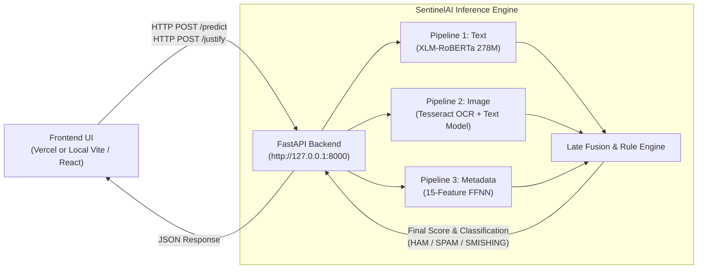

# SentinelAI — Complete Execution Guide (Backend & Frontend)

This guide provides step-by-step instructions to run, test, and integrate both the **SentinelAI FastAPI Backend** and the **Frontend Web Application**.

---

## 🏗️ System Architecture Overview



---

## 📋 Prerequisites

| Component | Requirement | Status / Notes |
| :--- | :--- | :--- |
| **Python** | Python 3.11.x | Configured in [`.venv`](file:///c:/Users/Deepak/OneDrive/Documents/projects/SentinelAI_Complete_Project/.venv) |
| **Node.js** | Node.js 18+ & npm | Only needed if running the frontend locally |
| **OCR Engine** | Tesseract OCR | Optional: needed only for image screenshot OCR |
| **Groq API Key** | `GROQ_API_KEY` | Optional: needed only for `/justify` AI explanation |

---

## 🚀 Part 1: Backend Execution Guide

### Step 1: Open Terminal & Activate the Virtual Environment

Open PowerShell in the project root directory (`c:\Users\Deepak\OneDrive\Documents\projects\SentinelAI_Complete_Project`):

```powershell
# 1. Allow script execution in current PowerShell process
Set-ExecutionPolicy -Scope Process -ExecutionPolicy Bypass

# 2. Activate the virtual environment
.\.venv\Scripts\Activate.ps1
```

*(If using Command Prompt `cmd.exe`, run: `.venv\Scripts\activate.bat`)*  
*(If using Git Bash, run: `source .venv/Scripts/activate`)*

You will see `(.venv)` appear at the beginning of your command line.

---

### Step 2: Verify Model Artifacts

SentinelAI requires its trained weights in the [`saved_models/`](file:///c:/Users/Deepak/OneDrive/Documents/projects/SentinelAI_Complete_Project/saved_models) directory:

Ensure the following files are present:
- `saved_models/text_model.pth` (~1.1 GB, fine-tuned XLM-RoBERTa)
- `saved_models/text_tokenizer/` (tokenizer config & vocab)
- `saved_models/metadata_model.pth` (FFNN weights)
- `saved_models/metadata_scaler.pkl` (StandardScaler)

> [!NOTE]
> If `saved_models/text_model.pth` is ever missing but `saved_models/text_model_best.pth` exists, copy it:
> ```powershell
> Copy-Item saved_models\text_model_best.pth saved_models\text_model.pth
> ```

---

### Step 3: Configure Environment Variables (Optional)

1. Copy `.env.example` to `.env`:
   ```powershell
   Copy-Item .env.example .env
   ```
2. Open `.env` and set optional keys if needed:
   ```env
   # Optional: Only needed for the /justify AI explanation endpoint
   GROQ_API_KEY=your_groq_api_key_here
   
   # Optional: Path to Tesseract if not in system PATH
   # TESSERACT_CMD=C:\Program Files\Tesseract-OCR\tesseract.exe
   ```

---

### Step 4: Start the Backend Server

Run Uvicorn from the project root:

```powershell
uvicorn app.main:app --host 127.0.0.1 --port 8000 --reload
```

You should see:
```text
INFO:     Started server process
INFO:     Waiting for application startup.
INFO:     Application startup complete.
INFO:     Uvicorn running on http://127.0.0.1:8000 (Press CTRL+C to quit)
```

---

### Step 5: Verify Backend Health & Interactive Docs

Open your browser and navigate to:
- **Interactive Swagger Docs**: [http://127.0.0.1:8000/docs](http://127.0.0.1:8000/docs)
- **Health Check Endpoint**: [http://127.0.0.1:8000/health](http://127.0.0.1:8000/health)

You should receive:
```json
{
  "status": "healthy",
  "version": "1.0.0",
  "models": {
    "text_model": true,
    "image_model": true,
    "metadata_model": true
  }
}
```

---

## 🎨 Part 2: Frontend Execution Guide

The project now includes both the **1:1 Vercel replica build** (`frontend_dist/`) and the **clean React + Vite source code** (`frontend/`).

---

### Option A: 1-Click Launch (Recommended — No Node.js Required)

You do **not** need Node.js or npm installed to run the frontend. A self-contained, high-performance Python SPA server is included:

1. In Windows Explorer or PowerShell, simply run:
   ```cmd
   run_frontend.bat
   ```
   *(Or run: `.venv\Scripts\python.exe run_frontend.py`)*

2. Your browser will automatically open:
   👉 **`http://127.0.0.1:5173`**

3. **What is included in this build:**
   - **100% pixel-perfect match** of the original Vercel design, animations, and Tailwind styling.
   - **Directly connected** to your local backend API at `http://127.0.0.1:8000`.
   - **Unlocked for guest use**: Supabase login redirect and demo query limits have been bypassed so you can analyze unlimited SMS messages and screenshots immediately.

---

### Option B: Running the Clean React + Vite Source Code

The complete, human-readable source code is located in the [`frontend/`](file:///c:/Users/Deepak/OneDrive/Documents/projects/SentinelAI_Complete_Project/frontend) directory. If you install Node.js in the future or want to deploy it to your own Vercel account:

```powershell
cd frontend
npm install
npm run dev
```

The frontend will run on `http://127.0.0.1:5173` and read `VITE_API_BASE_URL=http://127.0.0.1:8000` from [`frontend/.env`](file:///c:/Users/Deepak/OneDrive/Documents/projects/SentinelAI_Complete_Project/frontend/.env).

To deploy directly to Vercel:
1. Push `frontend/` to GitHub.
2. In Vercel dashboard, click **"Add New Project"** ➡️ import your GitHub repo.
3. Set **Root Directory** to `frontend`.
4. Add environment variable `VITE_API_BASE_URL` pointing to your deployed backend.
5. Click **Deploy**. Vercel will build and host it automatically.

---

## 🧪 Part 3: Automated Testing & Verification

With your backend server running on `http://127.0.0.1:8000`, open a **second terminal** and run the test scripts:

### 1. Run the Full Automated Pipeline Test
```powershell
Set-ExecutionPolicy -Scope Process -ExecutionPolicy Bypass
.\.venv\Scripts\Activate.ps1
python test_full_pipeline.py
```
This tests:
- Phishing SMS with suspicious URL
- Legitimate bank OTP alert
- Delivery notification
- Multimodal text + metadata fusion
- LLM justification endpoint

---

### 2. Manual cURL / PowerShell API Tests

#### Test Case 1: Phishing SMS with Suspicious URL
```powershell
Invoke-RestMethod -Uri "http://127.0.0.1:8000/predict" `
  -Method Post `
  -ContentType "application/json" `
  -Body '{"text": "URGENT: Your bank account is suspended. Verify immediately at http://fake-kyc-update.xyz", "url": "http://fake-kyc-update.xyz", "sender": "+919876543210"}'
```
**Expected Output**: `is_spam: true`, `score > 0.70`, `confidence: "HIGH"`.

---

#### Test Case 2: Legitimate Bank OTP
```powershell
Invoke-RestMethod -Uri "http://127.0.0.1:8000/predict" `
  -Method Post `
  -ContentType "application/json" `
  -Body '{"text": "Your OTP for HDFC Bank transaction is 482910. Valid for 10 minutes. Do not share with anyone.", "sender": "HDFCBK"}'
```
**Expected Output**: `is_spam: false`, `score < 0.25`, `confidence: "HIGH"`.

---

#### Test Case 3: AI Explanation Request (`/justify`)
```powershell
Invoke-RestMethod -Uri "http://127.0.0.1:8000/justify" `
  -Method Post `
  -ContentType "application/json" `
  -Body '{"text": "Your lottery prize of $10,000 is waiting. Claim at http://winner-claim.tk"}'
```
**Expected Output**: Clear human-readable justification breaking down urgency cues, domain risk, and advice.

---

## 🛠️ Common Troubleshooting

| Issue | Cause | Solution |
| :--- | :--- | :--- |
| **`Running scripts is disabled on this system`** | Windows PowerShell default ExecutionPolicy. | Run `Set-ExecutionPolicy -Scope Process -ExecutionPolicy Bypass` before activating `.venv`. |
| **`Model file not found at saved_models/text_model.pth`** | Best checkpoint was not renamed to production name. | Run `Copy-Item saved_models\text_model_best.pth saved_models\text_model.pth`. |
| **`CORS blocked by browser`** | Request sent from an unlisted port. | Add your port to `CORS_ORIGINS` in [`config.py`](file:///c:/Users/Deepak/OneDrive/Documents/projects/SentinelAI_Complete_Project/config.py#L22-L27) and restart Uvicorn. |
| **`Port 8000 already in use`** | Another instance of Uvicorn or another app is running. | Find and kill it with `Stop-Process -Id (Get-NetTCPConnection -LocalPort 8000).OwningProcess -Force` or run on port 8001: `--port 8001`. |
| **`TesseractNotFoundError`** | OCR called without Tesseract binary on machine. | Install Tesseract from [UB-Mannheim](https://github.com/UB-Mannheim/tesseract/wiki) or set `TESSERACT_CMD` in `.env`. (Text & metadata models work 100% fine without Tesseract). |

---

## 📌 Summary Quick-Command

To run the backend every day in one command:
```powershell
.\.venv\Scripts\Activate.ps1; uvicorn app.main:app --host 127.0.0.1 --port 8000 --reload
```
